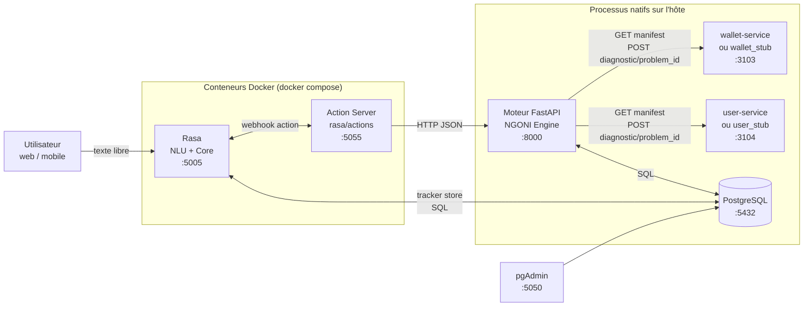

← [Sommaire](README.md) | [1. Présentation générale](01-presentation.md)

# 2. Architecture globale

## 2.1 Vue d'ensemble

Trois zones se dégagent :

1. **Compréhension et dialogue** (Rasa + Action Server) : comprend le
   message, maintient l'état de la conversation, décide de la prochaine
   action, et délègue toute logique métier au moteur FastAPI.
2. **Logique métier et orchestration** (moteur FastAPI) : FAQ, diagnostic,
   réclamations, feedback, embeddings partagés. C'est le seul composant qui
   parle SQL et qui appelle les microservices métier.
3. **Microservices métier** (wallet, user — réels ou stubs en développement) :
   propriétaires de leurs propres données et décisions ; le moteur ne fait
   que les interroger via un contrat standardisé (chapitre 7 des contrats,
   voir [`contracts/diagnostic/README.md`](../contracts/diagnostic/README.md)).

## 2.2 Composants et responsabilités

| Composant | Rôle | Ce qu'il NE fait PAS |
|---|---|---|
| **Rasa (Core + NLU)** | Comprend le langage naturel (intention, entités), maintient les slots et le contexte de conversation, décide de la prochaine action via ses policies. | N'exécute aucune logique métier ni requête SQL directement — délègue toujours à une action personnalisée. |
| **Action Server** (`rasa/actions`) | Exécute le code Python métier déclenché par le dialogue : appelle le moteur FastAPI, construit les réponses utilisateur, gère les formulaires (réclamation, diagnostic). | Ne stocke aucun état durable au-delà des slots de la conversation en cours ; aucune donnée persistante ne vit dans ce processus. |
| **Moteur FastAPI** | Point de vérité pour FAQ, tickets, feedback ; orchestre le Diagnostic Engine (Capability Registry, pipeline de résolution) ; expose le modèle d'embeddings partagé. | Ne décide jamais, à la place d'un microservice, si un problème est résolu ou non — il relaie et normalise la décision prise par le microservice concerné. |
| **wallet-service / user-service** (ou leurs stubs de dev) | Propriétaires des données et de la logique métier réelle (état d'un retrait, d'un KYC...). Décident eux-mêmes `RESOLVED` / `ESCALATE` / `NEED_MORE_INFO` pour leurs propres problèmes. | N'ont aucune connaissance du dialogue, de Rasa, ni des autres microservices. |
| **PostgreSQL** | Stockage relationnel unique : FAQ, tickets, feedback, embeddings, audit du diagnostic, et tracker Rasa (historique de conversation). | — |
| **pgAdmin** | Administration/inspection de la base en développement. | N'est jamais appelé par un composant applicatif. |

## 2.3 Qui décide, qui documente

Principe directeur repris de [`contracts/diagnostic/README.md`](../contracts/diagnostic/README.md)
et central à toute l'architecture du diagnostic : **le microservice métier
décide, le moteur FastAPI transporte et normalise, Rasa affiche**. Aucun
seuil métier (durée avant escalade, règles KYC...) ne vit dans le moteur
FastAPI ni dans Rasa — ils sont entièrement encapsulés dans le microservice
propriétaire du problème. Cette séparation est ce qui permet à une nouvelle
équipe microservice de rendre son service diagnosticable sans jamais avoir à
modifier le moteur ni le bot.

## 2.4 Le pattern Capability Registry

Plutôt qu'une liste de problèmes diagnosticables codée en dur, le moteur
FastAPI construit un **registre en mémoire** en interrogeant périodiquement
chaque microservice déclaré dans [`fastapi/services_registry.yaml`](../fastapi/services_registry.yaml)
sur `GET /diagnostic/manifest`. Conséquence directe de ce choix :

- Ajouter un problème diagnosticable à `wallet-service` ne nécessite **aucune**
  modification du moteur FastAPI ni de Rasa — il apparaît automatiquement au
  prochain cycle de rafraîchissement (`REGISTRY_POLL_INTERVAL_SECONDS`,
  300s par défaut).
- Rasa lui-même n'a **aucun registre statique** : il découvre entièrement ce
  qui est diagnosticable via `GET /diagnostic/capabilities`, mis en cache
  côté action server pendant 5 minutes.
- Un microservice injoignable au moment du rafraîchissement est simplement
  ignoré (log d'avertissement) plutôt que de faire échouer tout le registre.

Voir [7. Intégration des modèles IA](07-integration-ia.md) et
[8. Pipeline de traitement](08-pipeline-traitement.md) pour le détail du
calcul des embeddings associés à ce registre.

## 2.5 Choix technologiques et justification

| Choix | Alternative envisageable | Justification retenue dans ce projet |
|---|---|---|
| **Rasa** (NLU + Core, pipeline DIETClassifier) pour la compréhension du français | Un LLM généraliste (prompt engineering pur) | Contrôle fin du pipeline (garde-fou vocabulaire, seuils de fallback calibrés empiriquement), coût d'inférence prévisible, comportement déterministe et testable (`rasa test`), pas de dépendance à une API externe payante pour chaque message. |
| **FastAPI** avec une architecture par domaine (`app/domains/{faq,diagnostic,complaints,feedback}`) | Un monolithe Django/Flask, ou un split plus fin en microservices Python | Async natif (utile pour les appels HTTP concurrents vers les microservices), typage Pydantic partagé avec les contrats JSON Schema, granularité de domaine suffisante sans le coût opérationnel de microservices supplémentaires côté assistant. |
| **`sentence-transformers` / `intfloat/multilingual-e5-base`** pour la similarité sémantique | Correspondance par mots-clés uniquement, ou un modèle d'embeddings plus petit (e5-small) | Résiste aux fautes de frappe et reformulations ; le passage e5-small → e5-base a été justifié empiriquement (taux de faux positifs FAQ/diagnostic de 65 % → 10 %, voir [07-integration-ia.md](07-integration-ia.md)). |
| **PostgreSQL unique**, partagé entre le moteur FastAPI et le tracker store Rasa | Une base par service | Un seul système à opérer en développement ; les schémas restent logiquement séparés (`core`, `complaints`, tracker Rasa dans son propre schéma). |
| **Docker Compose limité à `rasa` + `actions`** | Conteneuriser l'ensemble de la stack (y compris FastAPI et Postgres) | Choix opérationnel délibéré de ce projet en développement : FastAPI, Postgres et les stubs tournent nativement sur l'hôte (`.venv` + `uvicorn`) pour un cycle d'itération plus rapide (rechargement à chaud, débogueur local) — voir [10. Déploiement](10-deploiement.md). `docker-compose.yml` définit néanmoins des services `postgres`/`fastapi` de repli, non utilisés dans le flux de travail actuel. |
| **Contrat versionné en JSON Schema** (`contracts/diagnostic/v1/`), avec miroir Pydantic | Documentation informelle du format d'échange | Rend le contrat vérifiable indépendamment du langage (Python côté moteur, PHP côté microservices Laravel), avec des exemples valides/invalides testables en CI. |

## 2.6 Contraintes actuelles

- **Mono-langue** : le pipeline NLU est entraîné et calibré exclusivement en
  français ; aucune détection ni support multilingue.
- **Environnement local / développement** : aucune authentification sur les
  endpoints du périmètre assistant (voir [13. Limitations actuelles](13-limitations.md)
  pour le détail et les recommandations de mise en conformité production).
- **Catalogue de diagnostic encore restreint** (8 problèmes au moment de la
  rédaction, répartis entre `wallet` et `user`) : plusieurs seuils de
  classification ont été calibrés empiriquement sur ce volume et devront être
  réévalués si le catalogue grossit significativement (voir
  [07-integration-ia.md](07-integration-ia.md)).

---

Suite : [3. Taxonomie du projet](03-taxonomie.md)
