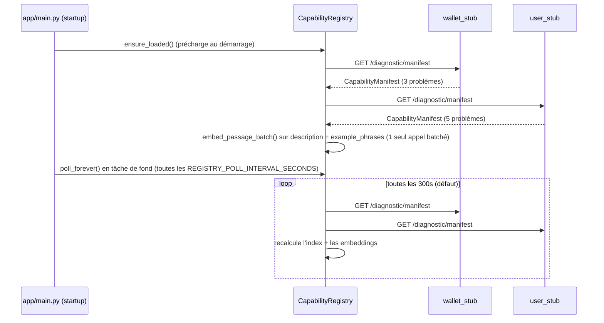
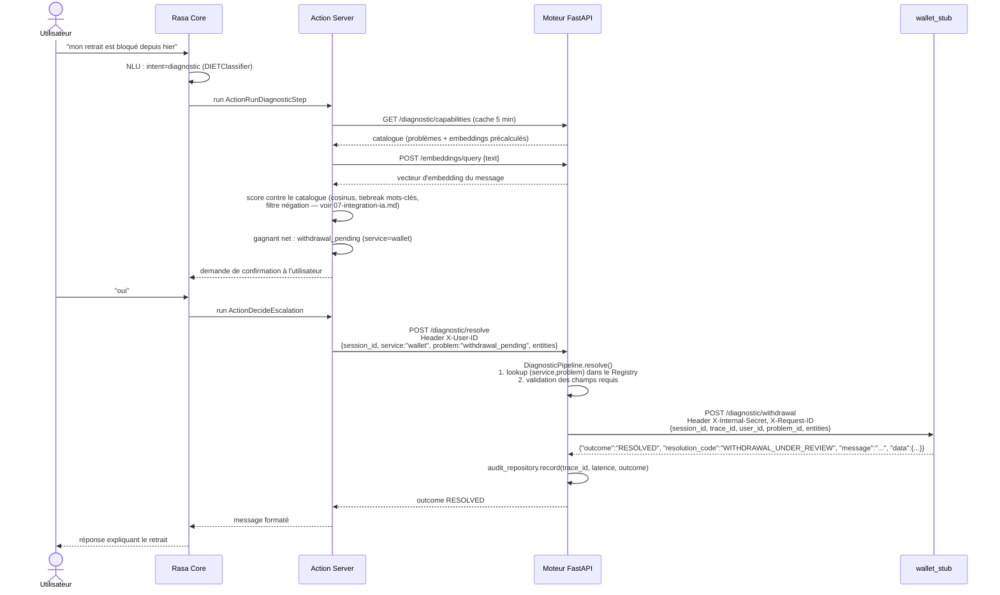
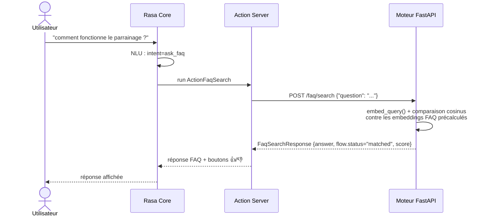

← [Sommaire](README.md) | [4. Architecture des services](04-services.md)

# 5. Communication entre les services

## 5.1 Vue d'ensemble des protocoles

Tous les échanges de ce périmètre sont du **HTTP/JSON synchrone**, sans file
de messages ni bus d'événements. Chaque appel sortant est protégé par un
timeout ; le Diagnostic Engine ajoute par-dessus un disjoncteur (circuit
breaker) pour éviter d'acharner un microservice déjà en difficulté.

## 5.2 Rasa Core ↔ Action Server

Rasa Core appelle `POST http://actions:5055/webhook` (configuré dans
`rasa/endpoints.yml`) à chaque fois qu'une story/règle prescrit une action
personnalisée. Le corps contient le `tracker` complet (slots, historique) et
le nom de l'action à exécuter ; la réponse contient les événements à
appliquer (nouveaux slots, messages à afficher).

## 5.3 Rasa ↔ Moteur FastAPI

L'Action Server appelle le moteur FastAPI en HTTP simple (`requests`, pas de
client généré). URLs configurées par variables d'environnement
(`rasa/actions/.env`, voir [9. Configuration](09-configuration.md)) :

| Action appelante | Endpoint FastAPI appelé |
|---|---|
| `ActionFaqSearch` | `POST /faq/search` |
| `ActionGreetWithTime`, `ActionBrowseFaq` | `GET /faq/suggestions` |
| `ActionRunDiagnosticStep` | `GET /diagnostic/capabilities` (mis en cache 5 min côté action server), `POST /embeddings/query`, `POST /embeddings/query/batch` |
| `ActionDecideEscalation` (via le pipeline) | `POST /diagnostic/resolve` |
| `ActionCreateTicket` | `POST /tickets/create` |
| `ActionStoreSuggestion`, `ActionAcknowledgeComplaint` | `POST /feedback` |
| `ActionRecordResponseRating` | `POST /feedback/ratings` |

## 5.4 Moteur FastAPI ↔ microservices (contrat de diagnostic)

Décrit intégralement par [`contracts/diagnostic/README.md`](../contracts/diagnostic/README.md) ;
résumé ici :

- `GET {base_url}/diagnostic/manifest` → `CapabilityManifest` (auto-description).
- `POST {base_url}{endpoint.path}` → `DiagnosticInvocationRequest` en entrée,
  une des trois formes `RESOLVED`/`ESCALATE`/`NEED_MORE_INFO` en sortie.
- En-têtes : `X-Internal-Secret` (authentification interne, valeur définie
  par service dans `services_registry.yaml`), `X-Request-ID` (= `trace_id`,
  corrélation de logs des deux côtés).

## 5.5 Rafraîchissement périodique du Capability Registry

## 5.6 Diagramme de séquence complet : "mon retrait est bloqué"

## 5.7 Diagramme de séquence : recherche FAQ sémantique

> Note : le moteur FastAPI expose aussi un raccourci `POST /api/chat` qui, si
> l'intention détectée par `/model/parse` est exactement `ask_faq`,
> court-circuite directement vers `FaqService.find_best_answer` sans repasser
> par le webhook Rasa — utilisé uniquement par l'interface de test intégrée
> (`/chat`), pas par le flux de production Rasa décrit ci-dessus.

## 5.8 Gestion des pannes

- **Microservice cible injoignable** (`DiagnosticInvocationError`, disjoncteur
  ouvert ou erreur réseau) : le pipeline **n'échoue jamais silencieusement** —
  il produit lui-même un `EscalateOutcome` avec `escalation_reason:
  "SERVICE_UNAVAILABLE"`, et le routeur crée automatiquement un ticket
  (`created_by="ai_auto_escalation"`), **sans confirmation utilisateur**
  supplémentaire. C'est une politique de résilience générique du moteur, pas
  une règle métier d'un service en particulier.
- **Service d'embeddings indisponible** : l'action server retombe sur un
  score par comptage de mots-clés (`_score_capabilities_keywords`) — dégradé
  mais fonctionnel.
- **Capability Registry vide ou périmé** : l'action server sert son dernier
  cache connu (jusqu'à 5 minutes) plutôt que de traiter une panne courte
  comme "rien n'est diagnosticable".
- **Rasa injoignable depuis le moteur** (`/api/chat`, `/api/parse`) : trois
  tentatives avec délai (`RASA_RETRY_COUNT`, `RASA_RETRY_DELAY`) avant de
  renvoyer une erreur `502` à l'appelant.

---

Suite : [6. Référence API](06-api-reference.md)
