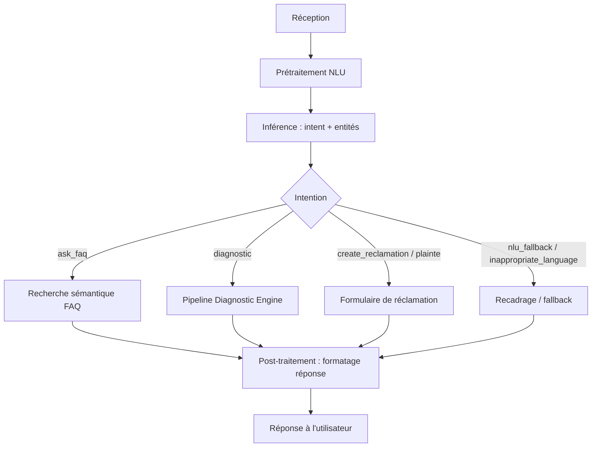
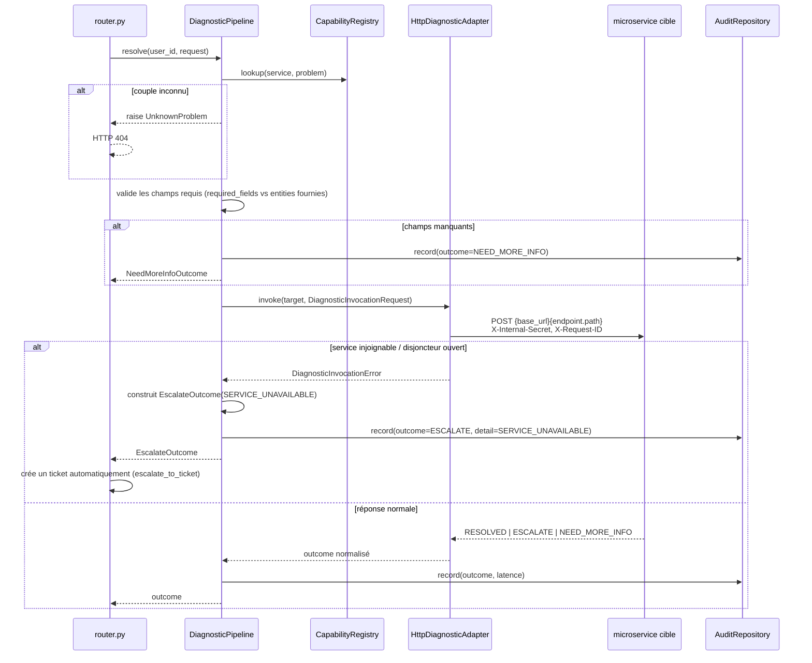

← [Sommaire](README.md) | [7. Intégration des modèles IA](07-integration-ia.md)

# 8. Pipeline de traitement

Ce chapitre décrit le parcours complet d'un message utilisateur, de sa
réception à la réponse renvoyée. Pour le détail des appels réseau entre
composants, voir [5. Communication entre les services](05-communication.md) ;
pour le détail des modèles IA impliqués, voir
[7. Intégration des modèles IA](07-integration-ia.md).

## 8.1 Vue d'ensemble

## 8.2 Réception

Le message entre par le canal `rest` (seul canal activé,
`rasa/credentials.yml`) : `POST /webhooks/rest/webhook`, corps `{ "sender",
"message" }`. `sender` identifie la conversation (et donc le tracker
associé, persisté en base — voir [4.5](04-services.md#45-stockage)).

## 8.3 Prétraitement (NLU)

Le texte traverse le pipeline de featurisation (tokenisation, features
lexico-syntaxiques, vecteurs de comptage sur mots entiers et sur
sous-chaînes de caractères) décrit en détail en
[7.2](07-integration-ia.md#72-modèle-nlu-diet-classifier). Cette étape ne
produit aucune décision, seulement les représentations numériques consommées
par le classifieur.

## 8.4 Inférence

1. `DIETClassifier` prédit une intention et des entités.
2. `VocabularyCoverageGuard` (composant personnalisé, voir
   [7.3](07-integration-ia.md#73-le-vocabulary_guard--garde-fou-personnalisé))
   force la confiance à `0.0` si aucun mot du message n'est reconnu.
3. `FallbackClassifier` bascule vers `nlu_fallback` si la confiance finale
   est sous le seuil, ou si les deux meilleures intentions sont trop
   proches.
4. Les policies Core (`RulePolicy`, `TEDPolicy`, `MemoizationPolicy`,
   `UnexpecTEDIntentPolicy`) décident, à partir de l'intention retenue et de
   l'état de la conversation, quelle action personnalisée exécuter.

## 8.5 Cas particulier : pipeline du Diagnostic Engine

C'est le sous-parcours le plus élaboré du système. Deux couches distinctes,
qu'il ne faut pas confondre :

### 8.5.1 Côté Action Server (Rasa) — classification du problème

Avant même d'appeler le moteur, l'action `ActionRunDiagnosticStep` doit
déterminer **quel** problème l'utilisateur décrit, parmi tout le catalogue
exposé par `GET /diagnostic/capabilities`. Chaîne de traitement (voir
`rasa/actions/diagnostic.py`) :

1. **Score par embeddings** du message entier contre le catalogue (meilleure
   similarité cosinus entre le message et la description + les
   `example_phrases` de chaque problème).
2. Si aucun gagnant net, **repli par segmentation en clauses** (le message
   est redécoupé sur les connecteurs grammaticaux — et/mais/car/donc... — et
   chaque proposition est réévaluée séparément), pour ne pas laisser un
   sujet secondaire diluer le vecteur moyen d'un message à plusieurs
   propositions.
3. **Filtre négation/résolution** : un candidat dont tous les mots-clés
   présents dans le message sont niés ("mon KYC n'est plus un souci") ou
   déjà résolus est retiré, même s'il obtient un bon score sémantique — les
   embeddings n'ont eux-mêmes aucune notion de polarité grammaticale.
4. **Désambiguïsation inter-services puis mots-clés** (tiebreak) si
   plusieurs candidats restent proches, avec un dernier **repêchage par
   mot-clé unique** en dernier recours.
5. **Détection multi-problèmes** : un message qui décrit plusieurs problèmes
   distincts et nets (ex. "je ne peux plus me connecter. Mon retrait est
   aussi en attente.") est segmenté par ponctuation forte et traité comme
   plusieurs candidats, pas un seul score dilué.

Le résultat de cette classification est ensuite confirmé auprès de
l'utilisateur avant d'être transmis au moteur — jamais appliqué
silencieusement.

### 8.5.2 Côté Moteur FastAPI — `DiagnosticPipeline.resolve()`

Une fois `(service, problem, entities)` confirmés, `POST /diagnostic/resolve`
délègue à un pipeline volontairement **générique et sans aucune logique
métier** (`app/domains/diagnostic/pipeline.py`) :

Étapes, dans l'ordre :

1. **Lookup** — remplace un `switch(service, problem)` codé en dur par une
   lecture de dictionnaire dans le Capability Registry.
2. **Validation générique de complétude** — comparaison d'ensembles de clés
   (`required_fields` du manifeste vs `entities` fournies), jamais une règle
   métier.
3. **Invocation** du microservice propriétaire du problème, via
   `HttpDiagnosticAdapter` (porte le disjoncteur, voir
   [8.5.3](#853-résilience--disjoncteur)).
4. **Normalisation** de la réponse contre l'enveloppe standard
   (`ResolvedOutcome` / `EscalateOutcome` / `NeedMoreInfoOutcome`).
5. **Traçabilité** — chaque appel est journalisé et enregistré en base
   (`DiagnosticAuditRepository`), avec `trace_id`, latence, et détail de
   l'issue — voir [12. Journalisation et supervision](12-logs-supervision.md).

### 8.5.3 Résilience — disjoncteur

`HttpDiagnosticAdapter` porte un disjoncteur (circuit breaker) **partagé
entre requêtes** (instance unique via `lru_cache` côté router) : ses échecs
consécutifs s'accumulent à travers les appels, pour qu'un microservice en
panne cesse rapidement d'être sollicité plutôt que d'accumuler des timeouts
un par un. Une invocation en échec (service injoignable ou disjoncteur
ouvert) devient systématiquement une escalade `SERVICE_UNAVAILABLE`, jamais
une erreur brute renvoyée au bot.

## 8.6 Post-traitement

- **FAQ** : la réponse trouvée est renvoyée telle quelle (pas de
  reformulation), avec le score de similarité pour audit côté logs.
- **Diagnostic** : le message de l'`outcome` (`RESOLVED.message`,
  `EscalateOutcome.message`) est rédigé par le microservice lui-même — le
  moteur ne le modifie pas ; seul `NEED_MORE_INFO` est traduit côté action
  server en une question posée à l'utilisateur pour le champ manquant
  suivant.
- **Réclamation/Feedback** : un résumé est généré (`ActionGenerateReclamationSummary`)
  et présenté pour confirmation avant la création effective du ticket.

## 8.7 Réponse à l'utilisateur

La réponse finale est un ou plusieurs messages Rasa (`utter_*` de
`domain.yml`, ou message construit dynamiquement par l'action), avec
éventuellement des boutons (`buttons: [{title, payload}]`) — par exemple les
catégories de FAQ ou les choix "Oui/Non" de confirmation d'un diagnostic. Le
client (widget `/chat` du moteur FastAPI, ou tout autre frontend) les affiche
tels quels ; un clic sur un bouton renvoie exactement le `payload` comme s'il
avait été tapé au clavier, garantissant un traitement identique aux deux
chemins.

---

Suite : [9. Configuration](09-configuration.md)
