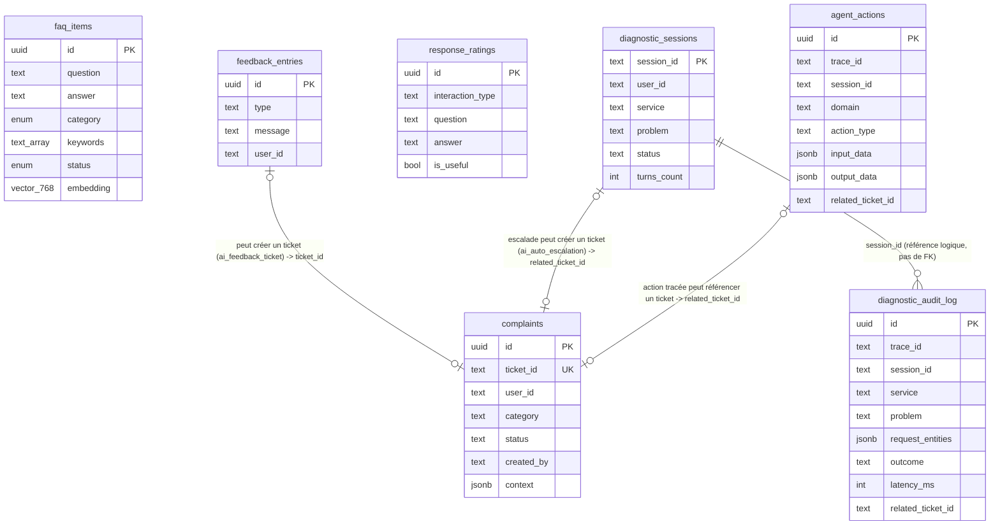

← [Sommaire](README.md) | [14. Perspectives d'évolution](14-evolutions.md)

# 15. Modèle de données

Ce chapitre documente le schéma PostgreSQL réel utilisé par le périmètre
assistant — absent des chapitres précédents, qui ne couvraient que les
formats d'échange API (Pydantic, voir [6. Référence API](06-api-reference.md)),
pas le stockage sous-jacent. Source : `fastapi/init_db.sql`, les modèles
SQLAlchemy de chaque domaine (`app/domains/*/models.py`), et
`wallet_stub/db.py` / `user_stub/db.py`.

## 15.1 Vue d'ensemble

Une seule instance PostgreSQL (voir [4.5](04-services.md#45-stockage)),
organisée en **schémas séparés par responsabilité** — pas de préfixe de
table, l'isolation logique passe entièrement par le schéma Postgres :

| Schéma | Propriétaire | Contenu |
|---|---|---|
| `core` | Moteur FastAPI — domaine FAQ | `faq_items` (avec embeddings `pgvector`) |
| `complaints` | Moteur FastAPI — domaine Complaints | `complaints` (tickets) |
| `feedback` | Moteur FastAPI — domaine Feedback | `entries`, `response_ratings` |
| `diagnostic` | Moteur FastAPI — Diagnostic Engine | `diagnostic_sessions`, `diagnostic_audit_log` |
| `wallet` | **Lecture seule** — clone de `ngoni-wallet-service`, consulté par `wallet_stub` | `wallets`, `wallet_transactions` |
| `users` | **Lecture seule** — clone de `ngoni-user-service`, consulté par `user_stub` | `users`, `kyc_submissions`, `compliance_events`, `account_deletions`, `parental_consents` |
| *(public/défaut)* | Tracker Rasa | `events` — créée et gérée automatiquement par Rasa, jamais lue ni écrite par le moteur FastAPI |

Aucune contrainte de clé étrangère n'existe **entre** ces schémas (ex. entre
`complaints.complaints.user_id` et `users.users.id`) : les identifiants
utilisateur voyagent en texte libre d'un bout à l'autre du système (voir
[15.9](#159-conventions-de-modélisation)), jamais garantis référentiellement
au niveau base — la cohérence est de la responsabilité applicative.



## 15.2 Schéma `core` — FAQ

```sql
CREATE TABLE core.faq_items (
    id UUID PRIMARY KEY,
    question TEXT NOT NULL,
    answer TEXT NOT NULL,
    category core."FaqCategory" NOT NULL,   -- ENUM Postgres natif
    keywords TEXT[] NOT NULL DEFAULT '{}',
    is_featured BOOLEAN NOT NULL DEFAULT FALSE,
    sort_order INTEGER NOT NULL DEFAULT 0,
    locale VARCHAR(5) NOT NULL DEFAULT 'fr',
    slug VARCHAR(160) NOT NULL UNIQUE,
    status core."FaqStatus" NOT NULL DEFAULT 'PUBLISHED',
    show_on_mobile BOOLEAN NOT NULL DEFAULT TRUE,
    show_on_web BOOLEAN NOT NULL DEFAULT TRUE,
    created_by UUID,
    updated_by UUID,
    embedding vector(768) NOT NULL,          -- extension pgvector
    created_at TIMESTAMP(3) NOT NULL DEFAULT now(),
    updated_at TIMESTAMP(3) NOT NULL DEFAULT now()
);
```

**`embedding vector(768)`** : type natif de l'extension `pgvector`
(`CREATE EXTENSION IF NOT EXISTS vector`, en tête de `init_db.sql`) — pas un
`float[]` générique ni un `JSONB`. La dimension 768 correspond au modèle
`intfloat/multilingual-e5-base` (voir [7.5](07-integration-ia.md#75-modèle-dembeddings-intfloatmultilingual-e5-base)) ;
elle était `vector(384)` avant la migration
`0001_e5_base_upgrade.sql`. **Deux vecteurs ne sont comparables que s'ils
viennent du même modèle** — tout changement de modèle d'embeddings implique
de recalculer la colonne entière (`scripts/reembed_faq.py`, voir
[7.6](07-integration-ia.md#76-remplacer-le-modèle-dembeddings)), pas une
migration de type seule.

`FaqCategory` / `FaqStatus` sont ici de vrais types `ENUM` Postgres (au
contraire des colonnes de provenance des autres schémas, voir
[15.9](#159-conventions-de-modélisation)) — cohérent avec Pydantic
(`FaqCategory`/`FaqStatus` en Python, voir [6.1](06-api-reference.md#61-fastapi--faq-faq-base-httplocalhost8000)).

## 15.3 Schéma `complaints` — tickets

```sql
CREATE TABLE complaints.complaints (
    id UUID PRIMARY KEY DEFAULT gen_random_uuid(),
    ticket_id TEXT UNIQUE NOT NULL,          -- format CMP-YYYYMMDD-XXXXXXXX
    user_id TEXT,
    category TEXT NOT NULL,
    description TEXT NOT NULL,
    summary TEXT,
    urgency TEXT NOT NULL DEFAULT 'medium',
    status TEXT NOT NULL DEFAULT 'OPEN',
    order_number TEXT,
    incident_date TEXT,
    department TEXT,
    additional_info TEXT,
    context JSONB,                            -- libre, jamais interprété en SQL
    created_by TEXT NOT NULL
        CONSTRAINT chk_complaints_created_by
        CHECK (created_by IN (
            'user_reclamation_form', 'user_diagnostic_escalation',
            'ai_auto_escalation', 'ai_feedback_ticket'
        )),
    created_at TIMESTAMPTZ NOT NULL DEFAULT now(),
    updated_at TIMESTAMPTZ NOT NULL DEFAULT now()
);
```

`created_by` trace l'origine du ticket (voir [1.3](01-presentation.md#13-cas-dutilisation) et
[6.3](06-api-reference.md#63-fastapi--réclamations-complaints)) : formulaire
utilisateur, escalade automatique du Diagnostic Engine, ou ticket créé à
partir d'un feedback (`suggestion`/`plainte`). `context` porte le contexte
libre transmis par l'appelant (ex. `service`/`problem`/`entities` d'une
escalade diagnostique) — jamais relu ni interprété côté SQL, uniquement pour
consultation humaine.

## 15.4 Schéma `feedback` — suggestions, plaintes, notations

```sql
CREATE TABLE feedback.entries (
    id UUID PRIMARY KEY,
    type TEXT NOT NULL CHECK (type IN ('suggestion', 'complaint_sentiment')),
    message TEXT NOT NULL,
    user_id TEXT,
    created_by TEXT NOT NULL DEFAULT 'ai_agent',
    ticket_id TEXT,                   -- lien vers complaints.ticket_id (voir migrations/0007)
    created_at TIMESTAMPTZ NOT NULL DEFAULT now()
);

CREATE TABLE feedback.response_ratings (
    id UUID PRIMARY KEY,
    interaction_type TEXT NOT NULL CHECK (interaction_type IN ('faq')),
    question TEXT NOT NULL,
    answer TEXT NOT NULL,
    is_useful BOOLEAN NOT NULL,
    user_id TEXT,
    created_by TEXT NOT NULL DEFAULT 'ai_agent',
    created_at TIMESTAMPTZ NOT NULL DEFAULT now()
);
```

Deux tables distinctes et volontairement non fusionnées : `entries` porte un
message libre sans rapport avec une réponse précise du bot (intentions
Rasa `suggestion`/`plainte`) ; `response_ratings` est **toujours** liée à un
couple `(question, answer)` précis (boutons 👍/👎 après une réponse FAQ) —
permet d'étudier après coup quelles réponses sont jugées utiles, pas
seulement un score global. Depuis `migrations/0005_feedback_ticket_created_by.sql`,
une entrée `suggestion`/`complaint_sentiment` crée en plus une ligne dans
`complaints.complaints` (`created_by = 'ai_feedback_ticket'`) — chaque
plainte/suggestion reste suivie par l'équipe support, pas seulement
consultable en base.

## 15.5 Schéma `diagnostic` — traçabilité du Diagnostic Engine

```sql
CREATE TABLE diagnostic.diagnostic_sessions (
    session_id TEXT PRIMARY KEY,      -- même identifiant que le tracker Rasa
    user_id TEXT,
    service TEXT,
    problem TEXT,
    status TEXT NOT NULL DEFAULT 'IN_PROGRESS',   -- IN_PROGRESS | RESOLVED | ESCALATED
    last_outcome TEXT,
    turns_count INTEGER NOT NULL DEFAULT 0,
    created_at TIMESTAMPTZ NOT NULL DEFAULT now(),
    updated_at TIMESTAMPTZ NOT NULL DEFAULT now()
);

CREATE TABLE diagnostic.diagnostic_audit_log (
    id UUID PRIMARY KEY DEFAULT gen_random_uuid(),
    trace_id TEXT NOT NULL,
    session_id TEXT NOT NULL,
    user_id TEXT,
    service TEXT NOT NULL,
    problem TEXT NOT NULL,
    called_endpoint TEXT,
    request_entities JSONB,
    outcome TEXT NOT NULL,             -- RESOLVED | ESCALATE | NEED_MORE_INFO
    outcome_detail TEXT,
    latency_ms INTEGER,
    related_ticket_id TEXT,            -- lien vers complaints.ticket_id (voir migrations/0007)
    created_at TIMESTAMPTZ NOT NULL DEFAULT now()
);
CREATE INDEX idx_diagnostic_audit_log_session_id ON diagnostic.diagnostic_audit_log (session_id);
```

Deux granularités distinctes (voir [12.3](12-logs-supervision.md#123-traçabilité-inter-services)) :
`diagnostic_sessions` porte **l'état courant** d'une conversation (une ligne
par `session_id`, mise à jour à chaque tour) ; `diagnostic_audit_log` porte
**l'historique complet**, jamais modifié (une ligne par appel à
`/diagnostic/resolve`, y compris `NEED_MORE_INFO`). `related_ticket_id` est
renseigné a posteriori par `DiagnosticAuditRepository.link_latest_escalation()`
quand une escalade `SERVICE_UNAVAILABLE` aboutit à un ticket automatique —
absent au moment de l'écriture initiale (le ticket n'existe qu'après le
retour de `pipeline.resolve()`, voir [8.5.2](08-pipeline-traitement.md#852-côté-moteur-fastapi--diagnosticpipelineresolve)),
et volontairement résolu par la ligne `ESCALATE`/`SERVICE_UNAVAILABLE` la
plus récente pour la session plutôt que par `trace_id` (non transmis
jusqu'au routeur) — best-effort, comme le reste de cet audit.

## 15.6 Schéma `audit` — traçabilité cross-domaine

```sql
CREATE TABLE audit.agent_actions (
    id UUID PRIMARY KEY DEFAULT gen_random_uuid(),
    trace_id TEXT,
    session_id TEXT,
    user_id TEXT,
    domain TEXT NOT NULL CHECK (domain IN ('faq', 'diagnostic_classification')),
    action_type TEXT NOT NULL CHECK (action_type IN (
        'faq_answer_served', 'faq_answer_not_found', 'problem_classified'
    )),
    input_data JSONB,
    output_data JSONB,
    related_ticket_id TEXT,
    created_at TIMESTAMPTZ NOT NULL DEFAULT now()
);
CREATE INDEX idx_agent_actions_session_id ON audit.agent_actions (session_id);
CREATE INDEX idx_agent_actions_domain ON audit.agent_actions (domain);
```

Table générique introduite pour couvrir des décisions autonomes qui
n'avaient **jusque-là aucune trace persistée**, hors du périmètre déjà
couvert par `diagnostic.diagnostic_audit_log` (dédié à `/diagnostic/resolve`
uniquement, resté inchangé) :

| `domain` | `action_type` | Écrit par | Ce qui manquait avant |
|---|---|---|---|
| `faq` | `faq_answer_served` / `faq_answer_not_found` | `app/domains/audit/service.py::record_faq_lookup`, appelé depuis `faq/router.py` (`POST /faq/search`) et `app/main.py` (`/api/chat`) | Une réponse FAQ non notée par l'utilisateur (pas de 👍/👎) ne laissait strictement aucune trace, même dans `feedback.response_ratings`. |
| `diagnostic_classification` | `problem_classified` | `rasa/actions/diagnostic.py::_report_agent_action`, appelé une seule fois au **verrouillage** d'un nouveau problème (pas à chaque tour) dans `ActionRunDiagnosticStep.run()` | Toute la chaîne de classification décrite en [8.5.1](08-pipeline-traitement.md#851-côté-action-server-rasa--classification-du-problème) (scores, désambiguïsation, filtre négation) ne produisait **aucun log, même éphémère** — seul le `problem` final envoyé à `/diagnostic/resolve` était visible côté moteur, sans le detail du "pourquoi". |

Écrite depuis deux endroits différents pour une raison d'architecture : les
réponses FAQ sont calculées **dans** le process FastAPI (écriture directe en
base) alors que la classification diagnostique est calculée **dans** le
process `actions` de Rasa, qui n'a pas d'accès direct à PostgreSQL (seul le
moteur FastAPI parle SQL, voir [2.2](02-architecture.md#22-composants-et-responsabilités))
— d'où l'endpoint `POST /audit/actions` (voir
[6.7](06-api-reference.md#67-fastapi--traçabilité-des-actions-autonomes-audit)),
appelé en best-effort (timeout court, exception réseau avalée) pour ne
jamais retarder ni casser une réponse déjà envoyée à l'utilisateur — même
philosophie que `diagnostic.diagnostic_audit_log` depuis le début.

**Hors scope à ce stade** (voir [13. Limitations actuelles](13-limitations.md)) :
les décisions NLU pures (`nlu_fallback` déclenché, message classé
hors-sujet) ne sont pas encore tracées ici — la logique de dialogue
correspondante (`ActionDefaultFallback`, `ActionOutOfScope`) est finement
calibrée sur de nombreux cas limites documentés en commentaires ; l'ajout
d'une instrumentation y a été jugé plus risqué que la valeur immédiate
qu'il apporterait. Seul le tracker Rasa brut (`events`, voir
[15.8](#158-tracker-store-rasa)) en garde une trace non structurée.

## 15.7 Schémas clones en lecture seule (`wallet`, `users`)

Ces deux schémas ne sont **jamais écrits** par le moteur ni les stubs — ce
sont des clones du contenu réel de `ngoni-wallet-service` et
`ngoni-user-service`, utilisés uniquement pour que `wallet_stub`/`user_stub`
puissent répondre avec des données réalistes (voir
[4.4](04-services.md#44-microservices-consommés-par-le-diagnostic-engine)).
Les modèles SQLAlchemy correspondants (`wallet_stub/db.py`,
`user_stub/db.py`) ne déclarent que le **sous-ensemble de colonnes** lu par
le diagnostic, pas le schéma complet du service réel.

**`wallet.wallets`** / **`wallet.wallet_transactions`** — champs clés :
`kyc_verified`, `status`, `frozen_reason`, `monthly_limit`,
`total_withdrawals` (wallet) ; `type`, `status`, `reference_id`,
`provider_transaction_id`, `error_code` (transactions).

**`users.users`** / **`users.kyc_submissions`** / **`users.compliance_events`** /
**`users.account_deletions`** / **`users.parental_consents`** — champs clés :
`status`, `kyc_status`, `kyc_level`, `suspension_reason`, `compliance_hold`
(users) ; `status`, `rejection_reason` (KYC) ; `soft_deleted_at`,
`hard_delete_scheduled_for`, délai de grâce de 30 jours (suppression de
compte) ; `child_id`/`parent_id`, `status` (consentement parental).

> ⚠️ **Divergence connue avec `init_db.sql`** : ce fichier déclare encore un
> schéma `wallet_stub` (tables `wallets`/`withdrawals`, colonnes différentes)
> qui ne correspond **plus** aux modèles réellement utilisés par le code
> actuel de `wallet_stub` (`db.py`, schéma `wallet`) — voir
> `wallet_stub/README.md`, qui documente explicitement le schéma `wallet`
> comme clone en lecture seule. `init_db.sql` n'a apparemment pas été tenu à
> jour lors du passage au modèle "clone réel" ; aucun schéma `user_stub`
> équivalent n'y figure non plus. Comme pour la divergence déjà notée en
> [13.8](13-limitations.md#138-divergences-constatées-entre-code-et-documentation-existante),
> c'est du code (`db.py`, `README.md` des stubs) qu'il faut partir pour
> connaître le schéma réel, pas de `init_db.sql` seul.

## 15.8 Tracker store Rasa

Table `events` (créée et gérée automatiquement par Rasa au premier
démarrage, voir [9.2](09-configuration.md#92-fichiers-de-configuration-rasa)) :
historique brut des événements de conversation (slots, actions exécutées,
messages). Opaque pour le moteur FastAPI — ni lue ni écrite en dehors de
Rasa lui-même ; mentionnée ici uniquement parce qu'elle partage la même
instance PostgreSQL.

## 15.9 Conventions de modélisation

| Convention | Où | Pourquoi |
|---|---|---|
| `TEXT` + contrainte `CHECK` plutôt qu'`ENUM` Postgres | `complaints.created_by`, `feedback.entries.type`, `feedback.response_ratings.interaction_type` | Une nouvelle valeur reste un simple `DROP`/`ADD CONSTRAINT`, jamais une migration de type — au contraire de `core."FaqCategory"`/`"FaqStatus"`, plus stables et déjà `ENUM`. |
| `user_id` en `TEXT` (pas `UUID`) hors `core`/`wallet`/`users` | `complaints`, `feedback`, `diagnostic` | L'identité appelante (`tracker.sender_id` côté Rasa, `X-User-ID` côté Engine) n'est pas toujours un UUID valide (ex. `"frontend_user"` pour l'interface de test `/chat` sans utilisateur réel). |
| `JSONB` pour le contexte libre | `complaints.context`, `diagnostic_audit_log.request_entities` | Jamais interprété en SQL, uniquement pour lecture humaine/audit — pas de contrat figé à faire respecter par la base. |
| Pas de clé étrangère inter-schéma | Partout | Cohérence déléguée à l'application ; chaque schéma appartient à un domaine différent, parfois même à un service distinct (`wallet`/`users`) hors du contrôle du moteur. |
| Migrations manuelles numérotées (`NNNN_description.sql`) | `fastapi/migrations/` | Pas d'outil de migration automatisé (Alembic...) dans ce projet — voir [11.6](11-maintenance.md#116-migrations-de-schéma-bd). |

---

[← Sommaire](README.md)
