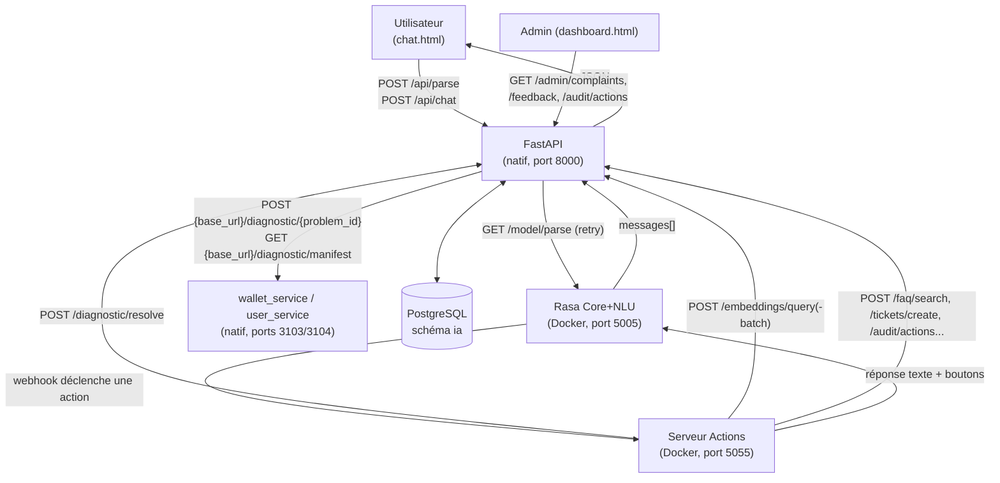

← [Sommaire général](../README.md)

# Rapport complet — du message utilisateur à la réponse

> **Rôle de ce document** : point d'entrée et table des matières. Ne contient
> aucun détail technique propre — chaque question précise a son propre
> chapitre ci-dessous, à lire indépendamment ou dans l'ordre.

Vérifié directement dans le code le 2026-07-31 (pas seulement dans la
documentation existante — voir [19. Vérifications et écarts](19-verifications-ecarts-doc.md)).
Ce rapport raconte **un seul parcours de bout en bout** : le frontend (chat +
dashboard), les deux processus FastAPI/Rasa, le serveur d'actions, le
Diagnostic Engine, et retour jusqu'à l'écran de l'utilisateur.

Pour le détail exhaustif d'un point précis non couvert ici, les chapitres
numérotés du [sommaire général](../README.md) restent la référence ; ce
rapport les relie entre eux dans l'ordre où l'exécution les traverse
réellement.

## Vue d'ensemble

Trois processus tournent en parallèle (voir [10. Déploiement](../10-deploiement.md)
pour la procédure de démarrage exacte) :

| Processus | Où | Rôle dans ce parcours |
|---|---|---|
| **FastAPI** (`fastapi/app`) | natif, port 8000 | Sert le frontend, expose toutes les API, héberge le Diagnostic Engine et le modèle d'embeddings |
| **Rasa** (`rasa/`) | Docker (`pfe-rasa-1`), port 5005 | NLU (intent + entités) et Core (quelle action exécuter) |
| **Actions** (`rasa/actions`) | Docker (`pfe-actions-1`), port 5055 | La quasi-totalité de la logique métier réelle |

`wallet_service`/`user_service` (natifs, ports 3103/3104) jouent le rôle des vrais
microservices métier pour le Diagnostic Engine (voir
[[project-ngoni-diagnostic-service-scope]] — un choix de périmètre assumé, pas
un manque).

## Table des matières

| # | Chapitre | Rôle précis |
|---|---|---|
| 1 | [Le frontend envoie le message](01-frontend-chat-controller.md) | Ce que fait `chat.controller.js` à chaque message tapé ou bouton cliqué |
| 2 | [`POST /api/parse`](02-api-parse.md) | L'endpoint qui classe l'intention pour affichage seul |
| 3 | [`POST /api/chat`](03-api-chat.md) | L'endpoint qui produit la vraie réponse du bot |
| 4 | [Le sélecteur de moteur NLU](04-selecteur-moteur-nlu.md) | Rasa vs les 5 classifieurs BGE-M3, point d'entrée unique |
| 5 | [Le pipeline NLU de Rasa](05-rasa-nlu-pipeline.md) | Les composants de `rasa/config.yml`, et un écart trouvé avec la doc |
| 6 | [Rasa Core, policies, domaine](06-rasa-core-policies-domain.md) | Comment Rasa choisit quelle action exécuter |
| 7 | [Diagnostic — classification sémantique](07-action-diagnostic-classification.md) | L'algorithme qui identifie quel problème l'utilisateur décrit |
| 8 | [Diagnostic — exécution de l'action](08-action-diagnostic-execution.md) | `ActionRunDiagnosticStep`, escalade, questions de champs |
| 9 | [Réclamations — le formulaire](09-action-reclamation-formulaire.md) | `reclamation_form` : description, catégorie, date, confirmation |
| 10 | [FAQ — recherche sémantique](10-action-faq.md) | Recherche de réponse, parcours par catégories |
| 11 | [Feedback, suggestions, notations](11-action-feedback.md) | Suggestions, plaintes, boutons "utile/pas utile" |
| 12 | [Résilience côté serveur Actions](12-resilience-actions-server.md) | Disjoncteurs, retries, cache de capacités |
| 13 | [Diagnostic Engine — le registre](13-diagnostic-engine-registry.md) | `CapabilityRegistry`, `services_registry.yaml` |
| 14 | [Diagnostic Engine — pipeline et contrats](14-diagnostic-engine-pipeline-contracts.md) | `DiagnosticPipeline.resolve`, les schémas JSON |
| 15 | [Diagnostic Engine — adapter et disjoncteur](15-diagnostic-engine-adapter-circuit-breaker.md) | Appel HTTP réel, disjoncteur par microservice, routes |
| 16 | [Les domaines simples derrière l'admin](16-domaines-admin-complaints-feedback-audit.md) | Réclamations, feedback, audit — ce que consomme le dashboard |
| 17 | [Retour jusqu'à l'utilisateur](17-retour-reponse-utilisateur.md) | Comment la réponse s'affiche réellement dans le chat |
| 18 | [Le modèle d'embeddings partagé](18-modele-embeddings-partage.md) | Un seul exemplaire pour toute la plateforme, pourquoi |
| 19 | [Vérifications effectuées et écarts trouvés](19-verifications-ecarts-doc.md) | Méthode de vérification, écart trouvé avec `08-pipeline-traitement.md` |
